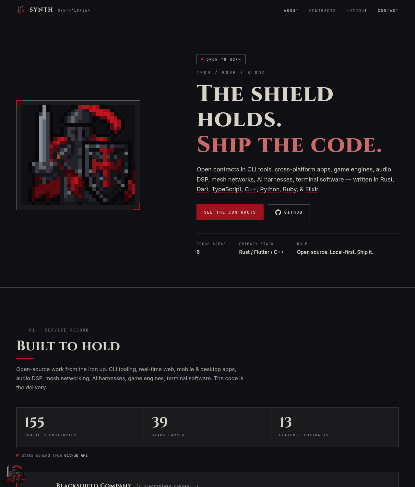

# synthalorian.github.io

Personal site of synth (synthalorian). Blackshield livery: matte black, blood red, steel and bone, with the Blackshield knight as the mascot.

**Live:** https://synthalorian.github.io

## What it is

Static portfolio on GitHub Pages. Single page, live GitHub stats, featured projects. The pixel knight idles in the bottom-left corner at every width; each press (Enter and Space too) plays his next move once: thinking, working, success, error. The 404 page shows him mid-error. Under `prefers-reduced-motion` the knight shows a still frame, the skill bars and counters show final values, and the reveal animation is off.

## Layout

- `index.html`: the page
- `404.html`: not-found page
- `css/blackshield.css`: palette variables (black `#101014`, blood `#C1121F`, steel `#8F959C`, bone `#D8D3C8`)
- `css/knight.css`: the knight sprite player (32x28 frames stepped by CSS)
- `css/style.css`: site styles
- `js/main.js`: GitHub stats, mobile nav, scroll reveal
- `js/sprite.js`: the corner knight
- `fonts/`: self-hosted Cinzel, Inter and JetBrains Mono (SIL OFL, licences included)
- `img/knight/`: the knight sprite strips and a still
- `img/og-synthalorian.png`: 1200×630 share card
- `favicon.svg`, `favicon-32.png`, `favicon.ico`, `apple-touch-icon.png`, `icon-512.png`: knight icons

## Local

Plain static files, no build step. `python3 -m http.server` from the repo root.

## License

Apache-2.0, see `LICENSE`. The fonts keep their own SIL OFL licences.
